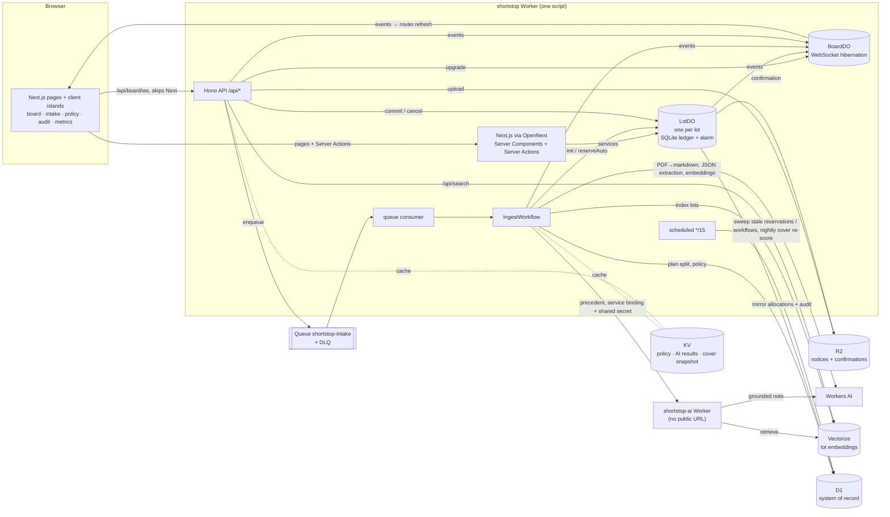

# ShortStop

**A drug-shortage allocation desk for a hospital network's central pharmacy. It runs entirely on Cloudflare's free tier.**

Live: **https://shortstop.shortstop-worker.workers.dev** (landing page). The desk is at **/app**: pick a demo persona from the switcher at the top right.

**Who it's for:** planners, pharmacists and the ops lead at an IDN central pharmacy. **The contested write:** two planners committing the same scarce lot at once. A Durable Object lets exactly one win.

How it maps to the course clusters A–F, item by item, is in [docs/CLUSTERS.md](docs/CLUSTERS.md). The Cluster C drill is in [docs/cluster-c-drill.md](docs/cluster-c-drill.md), and the review notes are in [docs/NOTES.md](docs/NOTES.md).

When a drug is in shortage, wholesalers stop shipping what you ordered and send *allocation notices* instead. These are emails, PDFs and portal messages saying "you get 150 vials, not 400". Someone at the central pharmacy then has to decide which of 10 hospitals gets how many. They do it under time pressure, often in a spreadsheet, while other planners work on the same lots.

ShortStop turns that into a shared, live desk:

1. **A model reads the mess.** You upload the notice as a PDF, an `.eml` or pasted text. Workers AI extracts the wholesaler, the products, the *allocated* quantities and the ETAs, then maps each product to the drug catalog. Anything that isn't a valid notice goes to triage instead of being guessed at.
2. **Deterministic code proposes the split.** It evens out days of cover across sites, weighted toward higher-acuity hospitals (ICU and oncology). The arithmetic is plain TypeScript, not AI, so it is reproducible and testable.
3. **Humans choose how much is automated.** The ops lead keeps an ordered list of autopilot rules, for example "small lots with confidence ≥ 0.85 → auto-commit". Each save is an immutable version.
4. **Hard floors no rule can override.** Tier-1 drugs (oncology, emergency, IV fluids) never auto-commit. Any lot that needs a therapeutic substitute waits for a pharmacist.
5. **An auto-commit is a 15-minute reservation, not a done deal.** The units are held at once. Any planner can cancel it, or take it over: the reserved split then loads into the planner's editor. A Durable Object alarm finalizes it. Policy can also mark lots *manual only*, where the planner must enter every quantity and the proposal is shown only for reference.
6. **Built for a queue.** The board is a triage list (*Needs you / Autopilot / Done*) sorted by who must act, tier and lowest cover, with keyboard shortcuts (`j`/`k`, `o`, `/`, `1`–`4`, `?`). Every human commit goes through one inline confirmation that names the drug, quantity, sites and lowest resulting cover.
7. **The ledger never goes negative.** When two planners commit the same scarce lot at the same moment, exactly one wins. The other immediately gets a fresh split of what's left.
8. **Past shortages inform the next one.** Every lot is embedded into Vectorize, so planners can search by meaning ("platinum chemo short at the cancer institute"). A separate RAG Worker writes a short precedent note for each new lot, citing only similar past lots it retrieved. Notes that aren't grounded are thrown away, and the AI never blocks an allocation.
9. **Everything is audited.** Every change gets an `audit_log` row, written in the same D1 transaction as the change. The `[AUDIT]` log line is emitted only after that write commits. Every auto-commit records the rule and policy version that fired. HTML and CSV confirmations are written to R2.

## Architecture



**The flow for one notice:**
1. Upload to R2, insert a `notices` row, enqueue.
2. The queue consumer starts `IngestWorkflow`, using the notice ID as the instance ID so it's idempotent.
3. The workflow steps are `load` (R2, then `AI.toMarkdown` or postal-mime), `extract` (Workers AI JSON mode, Zod validation, KV cache by content hash), `plan-lots` (split, substitute check, policy, hard floors, `LotDO.init` / `reserveAuto`) and `mark-ready`. Then come two advisory steps that can never fail the notice: `precedents` (the RAG Worker over the service binding, with an 8 s timeout) and `index-lots` (embeddings into Vectorize).
4. Planners commit through `LotDO.commit`. The DO checks availability and writes its SQLite ledger synchronously, before its first `await`. Because of that, concurrent commits are serialized and can never both pass the check.
5. The same synchronous block bumps a ledger **version** and appends the projection to an **outbox** (the transactional outbox pattern). `flush()` then projects outbox rows, in version order, into:
   - D1, where writes are guarded by `lots.state_version`, so a slow or retried projection can never move D1 backwards;
   - R2, as HTML and CSV confirmations;
   - `BoardDO`.
6. If a projection fails, for example because D1 is briefly unavailable, the ledger is still correct and the row stays in the outbox. The DO alarm retries it every 30 s until it lands (it reschedules itself rather than giving up), and the cron sweep separately finalises any reservation whose alarm was missed. No auto-commit can get stuck as `reserved`.

## Cloudflare services

| Building block | How ShortStop uses it |
|---|---|
| **D1** (+ Drizzle) | System of record: sites, drugs, substitutes, stock, users, notices, lots, allocations, policy versions, audit log, dead letters. Versioned migrations in `packages/db/migrations` |
| **KV** | Rebuildable caches only: the compiled current policy (for reads; the pipeline routes lots by the policy read fresh from D1), AI extraction results (by SHA-256 of the text), the nightly cover snapshot. Kept well under the free 1k writes/day |
| **R2** | Uploaded notices (PDF / .eml / text) and generated allocation confirmations (HTML + CSV per commit) |
| **Durable Objects** | `LotDO`: the only writer of a lot's remaining quantity. It keeps an SQLite ledger, a versioned outbox, and commit/cancel keys for idempotency, and uses alarms for both the autopilot window and projection retries. `BoardDO`: the live board over WebSocket hibernation, with presence. Events: `notice.ingested`, `lot.reserved`, `lot.committed`, `lot.rebased`, `lot.cancelled` and more |
| **Queues** (+ DLQ) | Buffers intake. The DLQ consumer mirrors dead letters into D1 and fails the notice visibly |
| **Workers AI** | `@cf/meta/llama-3.1-8b-instruct-fast` in JSON-schema mode for extraction and for grounded precedent notes; `toMarkdown` for PDFs; `@cf/baai/bge-base-en-v1.5` for embeddings |
| **Vectorize** | `shortstop-lots` index (768-dim, cosine): one vector per lot, with its summary as metadata. Powers `GET /api/search` and the RAG retrieval |
| **Service binding** | `AI_SVC`: the main Worker calls the `shortstop-ai` RAG Worker, which has `workers_dev: false`, a constant-time shared-secret check and a fallback to `null` |
| **Cron Triggers** | Every 15 min: finalize reservations whose alarm was missed, and fail notices whose workflow died. At 02:00 UTC: re-score days of cover, UPSERT it into `cover_history` (safe to run twice) and snapshot it into KV |
| **Audit** | `audit_log` rows plus `[AUDIT] {json}` log lines on every state change (Workers Logs / observability enabled) |
| *Beyond the list* | **Workflows** (durable ingest with per-step retries), **DO WebSocket hibernation** outside a game, **Static Assets** for the SPA, **Cloudflare Access** ready (see Auth) |

## Why it's built this way: the free-tier rules

The whole app runs on the Workers **Free** plan at $0. That shaped several choices:

- **Next.js under a soft CPU budget.** The UI is Next.js 16 on OpenNext in the same Worker ([ADR 0001](docs/adr/0001-free-plan-with-a-soft-cpu-budget.md), [ADR 0002](docs/adr/0002-opennext-over-vinext.md)). Next pages cost more than the Free plan's 10 ms of CPU, so that cost is measured (`scripts/cpu-sample.ts`) and any route that gets cut off falls back to a cheaper rendering, never to the Paid plan. `/api/*` and the WebSocket skip Next (~1–2 ms), and the landing page is prerendered and read from the static-assets cache. *(Until the gated cutover, the live site still serves the previous Vite SPA.)*
- **No PDF rendering in the Worker.** Confirmations are small HTML documents.
- **A small model, cached.** The 8B "fast" model keeps a full eval run of 10 notices well inside the free 10,000 neurons/day. Results are cached in KV, so workflow retries and re-uploads cost nothing.
- **No email in or out.** Email Routing needs a domain on Cloudflare, and sending email needs Workers Paid. Notices are uploaded instead, and `loadNoticeText` already parses `.eml`, so Email Workers could slot in as another intake adapter.
- **Uploads go through the Worker** (5 MB cap), so no R2 S3 credentials are needed.
- **Things deliberately left out:** Turnstile (there's no public form), the Rate Limiting binding (not confirmed available on the Free plan), AI Gateway and Analytics Engine. Cluster F is optional; see [docs/CLUSTERS.md](docs/CLUSTERS.md).

## Auth

- **Demo mode (default):** `DEMO_AUTH=true`. `/sign-in` sets an httpOnly `demo_user` cookie for one of the four fictional `@shortstop.demo` personas (`curl` and tests can send an `x-demo-user` header instead), and the role comes from D1. This is so reviewers can play every role without accounts. Demo sign-in refuses any other address with a 403, so it can never act as a real person's account. A banner marks the app as a demo, and all data is synthetic.
- **Cloudflare Access:** put an Access self-hosted app on the workers.dev hostname, then run `wrangler secret put ACCESS_AUD` and set `ACCESS_TEAM_DOMAIN`. The Worker then verifies the `Cf-Access-Jwt-Assertion` JWT with `jose`, and demo identities stop working. Use a hostname-based Access app, not the Worker-level toggle, because the Worker-level toggle returns 403 on WebSocket upgrades.

| Role | Can |
|---|---|
| Planner (Priya, Marcus) | submit notices, commit allocations, cancel or take over auto-commits |
| Pharmacist (Dana) | approve or reject substitutes |
| Ops lead (Olu) | everything a planner can do, plus edit the autopilot policy |

## Demo script (~5 min)

1. **Ops lead → Autopilot policy.** Show the three rules and the hard-floor box.
2. **New notice → "Multi-lot notice".** Submit it. Within a few seconds the board shows ondansetron and furosemide as *Autopilot pending, 14:59*, and cefazolin waiting for a planner, because the antibiotics rule matched.
3. **Two browsers, Priya and Marcus, on the cefazolin lot.** Marcus commits part of it. Priya's open editor immediately shows "Marcus just committed… only 140 left" and rebases. If they click at the same moment, the loser gets a 409 with the rebased split.
4. **"Cisplatin allocation (.eml)" and "Emergency syringes (PDF)".** These are tier-1, so they are manual only.
5. **"IV fluids, very short".** The split leaves sites under 5 days of cover, so lactated Ringer's is suggested as a substitute. Switch to **Dana (pharmacist)** to approve it, then a planner can commit.
6. **Take over** one pending auto-commit, so it shows in the audit trail as `lot.taken_over`.
7. **Audit trail.** Autopilot rows show `autopilot:small-confident-auto@v1`. Open a **Confirmation**, then **Metrics** (lowest cover, auto vs manual units, CSV export).
8. **"Not a notice" sample.** It lands in *Needs triage*: the model refuses rather than guesses.

## Tests and evals

```bash
pnpm test        # shared + AI Worker + Worker tests; Worker tests run in workerd via @cloudflare/vitest-plugin (no build, fully local, no AI calls)
pnpm typecheck   # also fails if the Durable Object migrations in wrangler.jsonc change
pnpm test:e2e    # Playwright against `opennextjs-cloudflare preview --env e2e`: build, fresh local D1, no queue consumer, no AI
pnpm eval        # extraction evals against the real Workers AI model (needs wrangler login)
```

- **`packages/shared`** covers the split engine (exact totals, weighting, determinism, shortfall), policy (first match wins, hard floors that can't be configured away), extraction validation, fuzzy catalog matching, and CSV cells that can't run as spreadsheet formulas.
- **`apps/worker/test/lot-do.test.ts`** covers:
  - a two-planner race and a 12-way race where the ledger never goes negative
  - D1 matching the ledger exactly after a race
  - partial commit plus rebase
  - idempotent commit and cancel replays
  - reserve, finalize and take-over handing back the split
  - the **real alarm** firing on its own
  - **injected D1 failure** during finalization, where the ledger stays correct and the alarm retry repairs D1
- **`apps/worker/test/api.test.ts`** covers auth and roles, the 409 rebase, the pharmacist gate (a refused second decision leaves no audit row), policy versioning, and Zod validation of inputs such as file keys and query parameters.
- **`apps/worker/test/pipeline.test.ts`** covers:
  - the full upload → queue → Workflow → board → commit → R2 confirmation path, with the AI step mocked via `introspectWorkflow`
  - every text and `.eml` fixture through the real loaders and validation, with mocked AI
  - triage, routing by policy, the substitute path and retry idempotency
  - the DLQ mirror and its audit row, the cron sweep and the cover snapshot
- **`apps/worker/evals/`** holds 10 notices with ground truth, including two that must be refused. The latest run scored 10/10. See [evals/README.md](apps/worker/evals/README.md).

## Run it yourself

```bash
pnpm install
pnpm db:migrate:local && pnpm db:seed:local
pnpm dev                       # OpenNext build + preview of the whole Worker: http://localhost:8787
```

To deploy to your own account:

```bash
pnpm exec wrangler login
# from apps/worker: wrangler d1 create shortstop · kv namespace create CACHE · r2 bucket create shortstop-files
#                   queues create shortstop-intake · queues create shortstop-intake-dlq   → put the IDs in wrangler.jsonc
pnpm db:migrate:remote && pnpm db:seed:remote
pnpm run deploy               # not `pnpm deploy`, which is pnpm's own built-in command
```

Seed data is generated by `packages/db/scripts/seed.ts` (`pnpm db:seed-sql`). The drugs are real ones that have appeared on US shortage lists. The hospitals, stock and demand are synthetic.

## Course scope (Project JEDI)

Clusters A–E are required, and F is optional. [docs/CLUSTERS.md](docs/CLUSTERS.md) maps every "What to build" item to code and tests, and answers the "questions to ask yourself". It also lists the two deliberate deviations:
- Next.js pages over the free 10 ms CPU limit, measured under a soft budget instead of forbidden;
- uploads through the Worker instead of presigned R2 URLs.

### Three modules that won't run on Workers (and what ShortStop uses instead)

Workers is a different runtime that happens to speak JavaScript, not Node with pieces missing. A package breaks there when it assumes a filesystem, a native binary or a long-lived socket. Each case below is one this app would have reached for:

1. **`pdf-parse`**: it reads from the filesystem when it loads, and Workers has no filesystem. Even with `nodejs_compat`, the bundle builds and then fails at runtime, on the first upload, deep inside a queue-driven workflow. ShortStop uses **`env.AI.toMarkdown`** instead (`ingest.ts` `pdfToText`), which turns the PDF into markdown on Cloudflare's side. The `08-epinephrine-letter.pdf` eval case exercises it against the real service.
2. **`better-sqlite3`**: a native C++ addon. Workers can't load `.node` binaries. ShortStop uses **D1** as the system of record and the **Durable Object SQLite storage API** (`ctx.storage.sql`) for the lot ledger. That gives SQLite semantics, including synchronous reads and writes inside the DO, with no native code.
3. **`nodemailer`**: it speaks SMTP over long-lived TCP/TLS sockets from Node's `net`/`tls` modules, and Workers has no `net` module. Email from a Worker goes through the `send_email` binding instead, which needs a domain on Cloudflare (and Workers Paid for arbitrary recipients). So, to stay at $0, ShortStop writes confirmations to R2. For parsing `.eml` files it uses **`postal-mime`**, which is built on web APIs and is the parser Cloudflare's Email Workers docs use.

## Repo layout

```
apps/worker/        main Worker + Next.js app: src/ (entry, API, services, DOs, Workflow, cron, search), app/ (App Router UI), test/, e2e/, evals/
apps/ai-worker/     RAG Worker (no public URL): Vectorize retrieval + grounded Llama precedent notes
packages/shared/    pure TS: Zod schemas, split engine, policy evaluator, extraction prompt + validation
packages/db/        Drizzle schema, migrations, seed generator
fixtures/notices/   sample notices + expected.json (demo samples and eval set)
docs/PLAN.md        design decisions from the planning session
docs/CLUSTERS.md    curriculum A–F mapping + Q&A; docs/cluster-c-drill.md; docs/NOTES.md
CONTEXT.md          domain glossary
```

## Known limits

- Demo auth is on by default so the panel can switch roles. It only covers the fictional personas, and the data is synthetic. Turn on Access (see Auth) before using any real data.
- Site stock is static seed data. A real deployment would sync on-hand stock from the hospitals' inventory systems.
- The cover snapshot on the Metrics page refreshes nightly, plus whenever it's missing.
- A lot that leaves sites short but has no catalogued substitute is not covered by a hard floor, so policy decides it. The default policy keeps tier-1 drugs manual.
