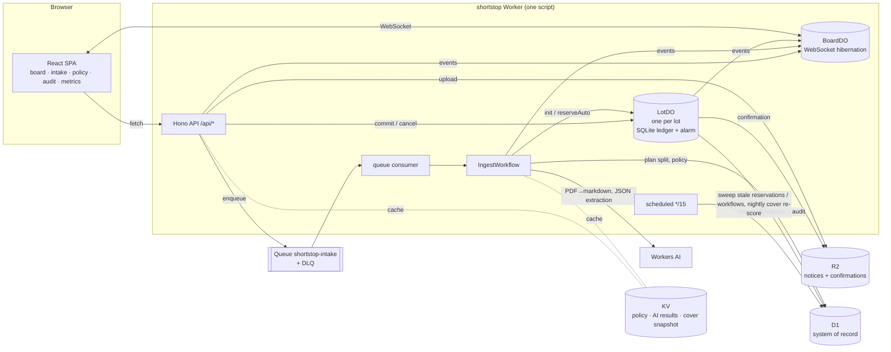

# ShortStop

**A drug-shortage allocation desk for a hospital network's central pharmacy. It runs entirely on Cloudflare's free tier.**

Live: **https://shortstop.shortstop-worker.workers.dev** (demo sign-in: pick a user from the switcher at the top right)

When a drug is in shortage, wholesalers stop shipping what you ordered and send *allocation notices* instead. These are emails, PDFs and portal messages saying "you get 150 vials, not 400". Someone at the central pharmacy then has to decide which of 10 hospitals gets how many. They do it under time pressure, often in a spreadsheet, while other planners work on the same lots.

ShortStop turns that into a shared, live desk:

1. **A model reads the mess.** You upload the notice as a PDF, an `.eml` or pasted text. Workers AI extracts the wholesaler, the products, the *allocated* quantities and the ETAs, then maps each product to the drug catalog. Anything that isn't a valid notice goes to triage instead of being guessed at.
2. **Deterministic code proposes the split.** It evens out days of cover across sites, weighted toward higher-acuity hospitals (ICU and oncology). The arithmetic is plain TypeScript, not AI, so it is reproducible and testable.
3. **Humans choose how much is automated.** The ops lead keeps an ordered list of autopilot rules, for example "small lots with confidence ≥ 0.85 → auto-commit". Each save is an immutable version.
4. **Hard floors no rule can override.** Tier-1 drugs (oncology, emergency, IV fluids) never auto-commit. Any lot that needs a therapeutic substitute waits for a pharmacist.
5. **An auto-commit is a 15-minute reservation, not a done deal.** The units are held at once, and any planner can cancel it or take it over. A Durable Object alarm finalizes it.
6. **The ledger never goes negative.** When two planners commit the same scarce lot at the same moment, exactly one wins. The other immediately gets a fresh split of what's left.
7. **Everything is audited.** Every change gets an `audit_log` row and an `[AUDIT]` log line. Every auto-commit records the rule and policy version that fired. Confirmations are written to R2.

## Architecture



**The flow for one notice:**
1. Upload to R2, insert a `notices` row, enqueue.
2. The queue consumer starts `IngestWorkflow`, using the notice ID as the instance ID so it's idempotent.
3. The workflow steps are `load` (R2, then `AI.toMarkdown` or postal-mime), `extract` (Workers AI JSON mode, Zod validation, KV cache by content hash), `plan-lots` (split, substitute check, policy, hard floors, `LotDO.init` / `reserveAuto`) and `mark-ready`.
4. Planners commit through `LotDO.commit`. The DO checks availability and writes its SQLite ledger synchronously, before its first `await`. Because of that, concurrent commits are serialized and can never both pass the check.
5. The DO then mirrors the result into D1 with idempotent writes, writes an HTML confirmation to R2, and broadcasts to `BoardDO`.

## Cloudflare services

| Building block | How ShortStop uses it |
|---|---|
| **D1** (+ Drizzle) | System of record: sites, drugs, substitutes, stock, users, notices, lots, allocations, policy versions, audit log, dead letters. Versioned migrations in `packages/db/migrations` |
| **KV** | Rebuildable caches only: the compiled current policy, AI extraction results (by SHA-256 of the text), the nightly cover snapshot. Kept well under the free 1k writes/day |
| **R2** | Uploaded notices (PDF / .eml / text) and generated allocation confirmations |
| **Durable Objects** | `LotDO`: the only writer of a lot's remaining quantity, with an SQLite ledger, idempotency keys and alarms for the autopilot window. `BoardDO`: the live board over WebSocket hibernation, with presence |
| **Queues** (+ DLQ) | Buffers intake. The DLQ consumer mirrors dead letters into D1 and fails the notice visibly |
| **Workers AI** | `@cf/meta/llama-3.1-8b-instruct-fast` in JSON-schema mode for extraction; `toMarkdown` for PDFs |
| **Cron Triggers** | Every 15 min: finalize reservations whose alarm was missed, and fail notices whose workflow died. At 02:00 UTC: re-score days of cover into KV |
| **Audit** | `audit_log` rows plus `[AUDIT] {json}` log lines on every state change (Workers Logs / observability enabled) |
| *Beyond the list* | **Workflows** (durable ingest with per-step retries), **DO WebSocket hibernation** outside a game, **Static Assets** for the SPA, **Cloudflare Access** ready (see Auth) |

## Why it's built this way: the free-tier rules

The whole app runs on the Workers **Free** plan at $0. That shaped several choices:

- **No Next.js.** The free plan allows 10 ms of CPU per request, so the UI is a Vite React SPA on Static Assets, which is free and doesn't count toward the request limit. The Worker only answers JSON.
- **No PDF rendering in the Worker.** Confirmations are small HTML documents.
- **A small model, cached.** The 8B "fast" model keeps a full eval run of 10 notices well inside the free 10,000 neurons/day. Results are cached in KV, so workflow retries and re-uploads cost nothing.
- **No email in or out.** Email Routing needs a domain on Cloudflare, and sending email needs Workers Paid. Notices are uploaded instead, and `loadNoticeText` already parses `.eml`, so Email Workers could slot in as another intake adapter.
- **Uploads go through the Worker** (5 MB cap), so no R2 S3 credentials are needed.
- **Things deliberately left out:** Vectorize, Turnstile, Analytics Engine and the Rate Limiting binding. Each would be a stretch feature with no core need here.

## Auth

- **Demo mode (default):** `DEMO_AUTH=true`. The SPA sends an `x-demo-user` header for one of the seeded users, and the role comes from D1. This is so reviewers can play every role without accounts.
- **Cloudflare Access:** put an Access self-hosted app on the workers.dev hostname, then run `wrangler secret put ACCESS_AUD` and set `ACCESS_TEAM_DOMAIN`. The Worker then verifies the `Cf-Access-Jwt-Assertion` JWT with `jose`, and demo identities stop working. Use a hostname-based Access app, not the Worker-level toggle, because the Worker-level toggle returns 403 on WebSocket upgrades.

| Role | Can |
|---|---|
| Planner (Priya, Marcus) | submit notices, commit allocations, cancel or take over auto-commits |
| Pharmacist (Dana) | approve or reject substitutes |
| Ops lead (Olu) | everything a planner can do, plus edit the autopilot policy |

## Demo script (~5 min)

1. **Ops lead → Autopilot policy.** Show the three rules and the hard-floor box.
2. **New notice → "Multi-lot notice".** Submit it. Within a few seconds the board shows ondansetron and furosemide as *Autopilot pending, 14:59*, and cefazolin waiting for a planner, because the antibiotics rule matched.
3. **Two browsers, Priya and Marcus, on the cefazolin lot.** Marcus commits part of it. Priya's open editor immediately shows "Marcus just committed… only 140 left" and rebases. If they click at the same moment, the loser gets a 409 with the rebased split.
4. **"Cisplatin allocation (.eml)" and "Emergency syringes (PDF)".** These are tier-1, so they are manual only.
5. **"IV fluids, very short".** The split leaves sites under 5 days of cover, so lactated Ringer's is suggested as a substitute. Switch to **Dana (pharmacist)** to approve it, then a planner can commit.
6. **Take over** one pending auto-commit, so it shows in the audit trail as `lot.taken_over`.
7. **Audit trail.** Autopilot rows show `autopilot:small-confident-auto@v1`. Open a **Confirmation**, then **Metrics** (lowest cover, auto vs manual units, CSV export).
8. **"Not a notice" sample.** It lands in *Needs triage*: the model refuses rather than guesses.

## Tests and evals

```bash
pnpm test        # 26 shared unit tests + 36 Worker tests (workerd via @cloudflare/vitest-plugin, fully local, no AI calls)
pnpm typecheck
pnpm eval        # extraction evals against the real Workers AI model (needs wrangler login)
```

- **`packages/shared`** covers the split engine (exact totals, weighting, determinism, shortfall), policy (first match wins, hard floors that can't be configured away), extraction validation and fuzzy catalog matching.
- **`apps/worker/test/lot-do.test.ts`** covers:
  - a two-planner race and a 12-way race where the ledger never goes negative
  - partial commit plus rebase
  - idempotent replay
  - reserve, finalize and cancel/take-over, with the R2 confirmation
- **`apps/worker/test/api.test.ts`** covers auth and roles, the 409 rebase, the pharmacist gate, policy versioning and file-key restrictions.
- **`apps/worker/test/pipeline.test.ts`** covers:
  - the full upload → queue → Workflow → board path, with the AI step mocked via `introspectWorkflow`
  - triage, routing by policy, the substitute path and retry idempotency
  - the DLQ mirror, the cron sweep and the cover snapshot
- **`apps/worker/evals/`** holds 10 notices with ground truth, including two that must be refused. The latest run scored 10/10. See [evals/README.md](apps/worker/evals/README.md).

## Run it yourself

```bash
pnpm install
pnpm db:migrate:local && pnpm db:seed:local
pnpm dev                       # http://localhost:5173
```

To deploy to your own account:

```bash
pnpm exec wrangler login
# from apps/worker: wrangler d1 create shortstop · kv namespace create CACHE · r2 bucket create shortstop-files
#                   queues create shortstop-intake · queues create shortstop-intake-dlq   → put the IDs in wrangler.jsonc
pnpm db:migrate:remote && pnpm db:seed:remote
pnpm deploy
```

Seed data is generated by `packages/db/scripts/seed.ts` (`pnpm db:seed-sql`). The drugs are real ones that have appeared on US shortage lists. The hospitals, stock and demand are synthetic.

## Repo layout

```
apps/worker/        one Worker: src/ (API, DOs, Workflow, cron), web/ (React SPA), test/, evals/
packages/shared/    pure TS: Zod schemas, split engine, policy evaluator, extraction prompt + validation
packages/db/        Drizzle schema, migrations, seed generator
fixtures/notices/   sample notices + expected.json (demo samples and eval set)
docs/PLAN.md        design decisions from the planning session
CONTEXT.md          domain glossary
```

## Known limits

- Demo auth is on by default so the panel can switch roles. Turn on Access before using real data.
- Site stock is static seed data. A real deployment would sync on-hand stock from the hospitals' inventory systems.
- The cover snapshot on the Metrics page refreshes nightly, plus whenever it's missing.
